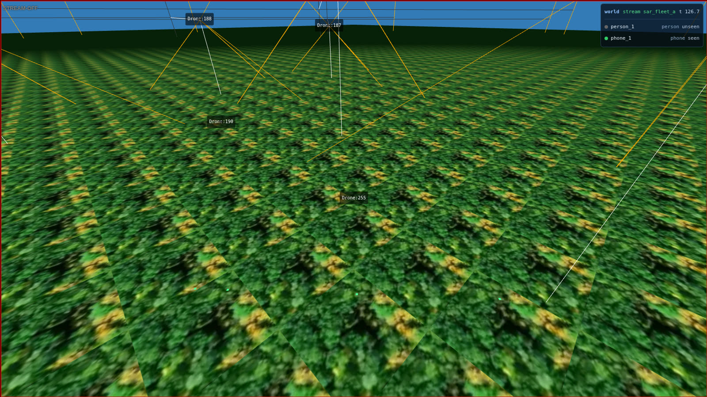

<p align="center">
  <picture>
    <source media="(prefers-color-scheme: dark)" srcset="docs/images/engage-studio-logo-dark.svg">
    
  </picture>
</p>

<p align="center">
  <b>Fly a whole drone fleet on your desk.</b><br>
  Real DroneEngage software · real servers · ArduPilot SITL · one command: <code>./sim</code>
</p>

<p align="center">
  <a href="#-quick-help">Quick help</a> ·
  <a href="#-see-it-search-and-rescue">Demo</a> ·
  <a href="#-install">Install</a> ·
  <a href="wiki/README.md">Wiki</a> ·
  <a href="wiki/USER_GUIDE.md">User guide</a>
</p>

---

**Engage Studio** (`droneengage_studio`) runs simulated copters, planes
and rovers that carry the **real** DroneEngage modules and talk to the
**real** DroneEngage servers — all on one machine, no drone, no radio,
no root. Bring up one quad to poke at, a six-drone search-and-rescue
swarm to watch, or a seeded fault test that CI grades for you.

- 🧱 **Compose** — describe a vehicle once (`blocks/`), build fleets from it (`sims/`).
- 🎬 **Rehearse** — one `de.scenario/1` file holds the fleet, the mission, the operator, the faults and the pass/fail checks.
- 💥 **Break things on purpose** — link cuts, packet loss, GPS jamming, motor-out, server crashes, all seeded and repeatable.
- 🌲 **Ground truth** — seeded worlds (people, phones, canopy, buildings) feed stub cameras and SDRs, so "did it find the person?" is a real assert.
- 🛰 **Watch it** — WebClient for the operator view, Mavlink3DMap for 3D.
- 🔌 **Not locked in** — DroneEngage is the flagship stack, not the owner ([`de.stack/1` adapter](docs/ADAPTER.md)).

---

## ⚡ Quick help

Five minutes from clone to two drones on your own servers.

**1. Start the servers** — authenticator, comm, storage, UDP proxy:

```bash
./sim up de_servers
```

**2. Connect a drone** — one quadcopter (SITL + `de_comm` + `de_mavlink`):

```bash
./sim up quadcopter
```

**3. Add a second drone** — same yaml, a new instance named `d2`:

```bash
./sim up quadcopter --shared --slot-base any --name d2
```

**4. Open the WebClient** and see both drones:

```bash
./sim up de_webclient --open-web
```

**5. Fly** — arm, take off, come home:

```bash
./sim ctl -s quadcopter mode quad1 GUIDED
./sim ctl -s quadcopter arm quad1
./sim ctl -s quadcopter takeoff quad1 20
./sim ctl -s quadcopter mode quad1 RTL
```

**6. Stop** — one drone, all sims, then the servers:

```bash
./sim down quadcopter_d2
./sim down
./sim down de_servers
```

> 💡 Logins come from `SIM_AUTH_*` in `sim.local.env`, or add
> `--user <email> --password <code>` to any `up`.

### More one-liners

| I want to... | command |
|---|---|
| list everything I can run | `./sim list` |
| see what is live | `./sim status` · `./sim sims` · `./sim servers` |
| a 3-copter session with planner + 3D | `./sim studio copters3` |
| add the 3D viewer to any sim | `./sim up quadcopter --with viewer` |
| watch a demo in 3D | `./sim view scenarios/demos/world_canopy_viewer.yaml` |
| run the smoke tests | `./sim suite --tier smoke` |
| run one test | `./sim run tests/smoke_copters.yaml` |
| rebuild + retry one module | `./sim try <test> --module de_mavlink=<path>` |
| reach my servers from a phone | `./sim up de_servers --out <my-ip>` |
| tail a log | `./sim logs quad1 de_comm` |
| record a live session as a scenario | `./sim record <sim> -o my_run.yaml` |
| make a new scenario | `./sim new my_run` → `./sim validate scenarios/my_run.yaml` |
| check this machine | `./sim doctor` |
| free disk | `./sim clean --dry-run` |

`./sim help` shows every command. `./sim <cmd> --help` shows its flags.

---

## 🚁 See it: search and rescue

Six copters run the reference SAR operation over a seeded forest. An SDR
scout picks up a lost hiker's phone, three searchers split the area into
sectors, a camera box finds the person, the operator confirms, and the
ambulance drone launches and drops a payload on them.

```bash
./sim view scenarios/demos/sar_fleet_a.yaml --with viewer
```

<p align="center">
  <br>
  <sub>The operator view: the camera scout and a searcher converge on <code>detect.detected</code>; the ambulance waits for the drop approval.</sub>
</p>

<table>
  <tr>
    <td width="50%"><br>
      <sub><b>Who talks to whom</b> — the live collaboration diagram: roles, units and every <code>detect.detected</code> hand-off.</sub></td>
    <td width="50%"><br>
      <sub><b>What happened when</b> — the per-unit timeline; hover any mark for the journal lines behind it.</sub></td>
  </tr>
  <tr>
    <td width="50%"><br>
      <sub><b>The fleet</b> — six units, their roles, active missions and layers.</sub></td>
    <td width="50%"><br>
      <sub><b>In 3D</b> — Mavlink3DMap over the seeded canopy, the phone already found.</sub></td>
  </tr>
</table>

Every step is graded — phone found, three disjoint sectors claimed,
person confirmed, payload dropped — and the results land in
`var/results/<utc>/sar_fleet_a/` (`summary.json`, `junit.xml`,
journals, telemetry, coverage). Story: [`scenarios/demos/sar_fleet_a.md`](scenarios/demos/sar_fleet_a.md).

---

## 🛠 Install

**Fastest — Docker** (SITL, DE binaries and the viewer baked in; Linux):

```bash
docker build -f docker/Dockerfile -t de-sim .
docker run -it --network host de-sim          # runs the canopy-search demo
```

**On your machine:**

```bash
cp sim.local.env.example sim.local.env    # set DE_CODE, ARDUPILOT_DIR, ...
./sim doctor                              # one OK/MISSING line per item, each with a fix
```

You need ArduPilot SITL, `de_comm` + `de_mavlink` built, the Rust servers
(`cargo build --release`) and `pip install websockets pymavlink pyyaml`.
Full list: [wiki/SETUP.md](wiki/SETUP.md).

---

## 🧭 How it fits together

```
 blocks/      one unit type      "a copter with a camera"
    │
 sims/        a fleet            "3 copters + a tower, on my servers"
    │
 tests/       machine-checked    steps + asserts, run by CI
 scenarios/   human-run          demos, examples, challenges
    │
 worlds/      ground truth       people, phones, canopy, wind
 packages/    operations         the missions the fleet deploys
```

| Server mode | What runs | Use it for |
|---|---|---|
| `real` (default) | the real `droneengage_server` (+ authenticator) per sim | real routing and login |
| `fake` | a seeded fake server | link loss, delay, cuts, clock faults |
| `external` | nothing — joins your `./sim up de_servers` | personal sims, phones, boards |

---

## 📚 Wiki

| Page | What is in it |
|---|---|
| [User guide](wiki/USER_GUIDE.md) | plain-English start, from zero |
| [Setup](wiki/SETUP.md) | Docker, `sim.local.env`, `doctor`, ESP32 HIL, requirements |
| [Blocks, sims and servers](wiki/BLOCKS_AND_SIMS.md) | block and fleet yaml, config layers, server types, accounts |
| [Parallel sims, studio and ports](wiki/PARALLEL_SIMS_AND_PORTS.md) | `--shared`, `--name`, `./sim studio`, the port allocator |
| [Tests and scenarios](wiki/TESTS_AND_SCENARIOS.md) | the `de.scenario/1` format, faults, asserts, operator console |
| [`./sim up quadcopter`, line by line](wiki/SIM_UP_QUADCOPTER.md) | every line of the output explained |
| [Running with a camera](wiki/RUNNING_WITH_CAMERA.md) | `de_camera` + a video device |
| [docs/SCENARIOS.md](docs/SCENARIOS.md) | the authoring reference — paste it to an LLM and it writes scenarios for you |
