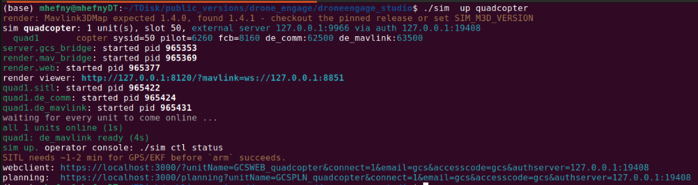

# `./sim up quadcopter` — what every line means

This is the annotated output of bringing up `sims/quadcopter.yaml`: a
personal, one-vehicle sim — ArduCopter SITL + `de_comm` + `de_mavlink` —
that joins **your own** server stack instead of spawning one.



---

## The output, line by line

```
render: Mavlink3DMap expected 1.4.0, found 1.4.1 - checkout the pinned release or set SIM_M3D_VERSION
```

A warning, not an error. This sim asks for `render: {mode: viewer}`,
which launches the Mavlink3DMap 3D viewer. The engine pins the viewer to
a specific release (here `1.4.0`), and your checkout reports `1.4.1`.
Either check out the pinned release, or set `SIM_M3D_VERSION=1.4.1` in
`sim.local.env` to accept what you have.

```
sim quadcopter: 1 unit(s), slot 50, external server 127.0.0.1:9966 via auth 127.0.0.1:19408
```

The plan summary. The sim defines **1 unit** (one vehicle). `slot 50` is
the sim's `slot_base` — every port it uses is derived from it, so several
sims can run side by side without colliding. `external server` means the
units will log into **your already-running** DroneEngage comm server on
port `9966`, authenticating through your authenticator on `19408`. The
sim starts nothing server-side itself.

```
  quad1       copter sysid=50 pilot=6260 fcb=8160 de_comm:62500 de_mavlink:63500
```

The one unit, named `quad1`, built from the `copter` block. Its numbers
all come from slot 50:

| Field | Value | What it is |
|---|---|---|
| `sysid` | 50 | MAVLink system ID of the vehicle |
| `pilot` | 6260 | TCP port where `de_mavlink` reaches the SITL flight controller (`5760 + 10*slot`) |
| `fcb` | 8160 | flight-controller board port (`7660 + 10*slot`) |
| `de_comm` | 62500 | the unit's comm broker bus port (`62000 + 10*slot`) |
| `de_mavlink` | 63500 | the unit's MAVLink bridge bus port (`63000 + 10*slot`) |

```
server.gcs_bridge: started pid 965353
```

The per-sim **GCS bridge** — a small helper that holds one persistent
GCS session on your external server. Even though the sim didn't start
the server, this keeps `./sim ctl` (the operator console) working.

```
render.mav_bridge: started pid 965369
render.web: started pid 965377
```

The two halves of the Mavlink3DMap viewer:

- `mav_bridge` — a UDP-to-WebSocket bridge. SITL streams MAVLink to it
  over UDP, and it re-serves that stream as a WebSocket on `8801 + slot`
  = **8851** for the viewer page.
- `web` — the viewer's web dev server on `8070 + slot` = **8120**.

```
render viewer: http://127.0.0.1:8120/?mavlink=ws://127.0.0.1:8851
```

The URL to open in a browser: the 3D map page on 8120, told to read
vehicle telemetry from the MAVLink WebSocket on 8851.

```
quad1.sitl: started pid 965422
quad1.de_comm: started pid 965424
quad1.de_mavlink: started pid 965431
```

The vehicle's three real processes are now running:

- `sitl` — the ArduCopter software-in-the-loop simulator (the vehicle's
  "physics + flight controller").
- `de_comm` — the unit's communication broker; every module on the
  vehicle talks to the outside world through it.
- `de_mavlink` — the bridge between the flight controller and the
  DroneEngage bus.

```
waiting for every unit to come online ...
all 1 units online (1s)
quad1: de_mavlink ready (4s)
```

The launcher waits for each process to report ready. The unit was on the
bus in about a second; `de_mavlink` finished its handshake with the
flight controller (heartbeat, parameters) about four seconds in.

```
sim up. operator console: ./sim ctl status
```

Bring-up is complete. `./sim ctl` is the operator console on the live
sim — status, arm, mode changes, and more.

```
SITL needs ~1-2 min for GPS/EKF before `arm` succeeds.
```

A reminder, not a step: the simulated autopilot must acquire GPS lock
and let its EKF (position estimator) converge before arming will pass
the pre-arm checks — just like real hardware.

```
webclient: https://localhost:3000/?unitName=GCSWEB_quadcopter&connect=1&email=gcs&accesscode=gcs&authserver=127.0.0.1:19408
planning:  https://localhost:3000/planning?unitName=GCSPLN_quadcopter&connect=1&email=gcs&accesscode=gcs&authserver=127.0.0.1:19408
```

Two ready-made URLs for the WebClient (the GCS web app, dev-served on
port 3000):

- **webclient** — the live ground-station view, logged in as identity
  `GCSWEB_quadcopter`.
- **planning** — the mission-planning view, logged in as a *different*
  identity `GCSPLN_quadcopter`, so both can be open at once without a
  name clash.

Both auto-connect (`connect=1`) and log in with `gcs`/`gcs` against your
authenticator at `127.0.0.1:19408`.

---

## What is now running

| Piece | Role | Port(s) |
|---|---|---|
| SITL (`quad1.sitl`) | simulated copter | pilot 6260, fcb 8160 |
| `quad1.de_comm` | unit comm broker | 62500 |
| `quad1.de_mavlink` | MAVLink ↔ bus bridge | 63500 |
| `server.gcs_bridge` | GCS session for `./sim ctl` | your server 9966 |
| `render.mav_bridge` | MAVLink UDP → WebSocket | ws 8851 |
| `render.web` | 3D viewer page | http 8120 |

Tear it all down with `./sim down quadcopter`.
